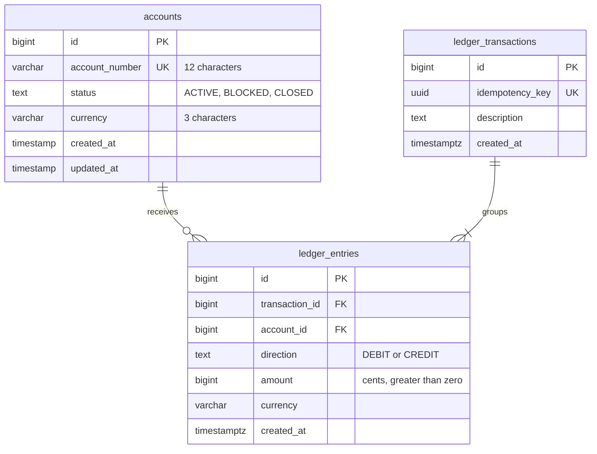
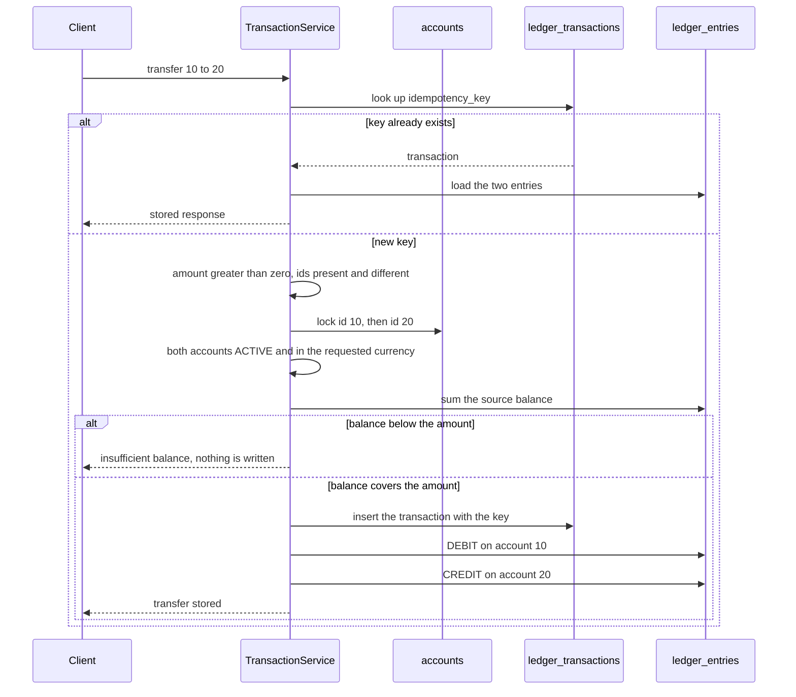

# Ledger

This document describes the ledger tables and the flow of a transfer. The versioned SQL lives in `src/main/resources/db/migration/`. The flow lives in `TransactionServiceImpl`.

## Model

A transfer does not update a balance stored on the account. It appends facts. The balance is the sum of those facts.

`accounts` is the account: number, currency, and status. There is no balance column. Status limits what the account can do. Currency is fixed at creation.

`ledger_transactions` is the event. `idempotency_key` is unique, so repeating the same request returns the transfer already stored instead of debiting again. The transaction has no amount column and does not point at the accounts. The entries are what moved the money.

`ledger_entries` is the accounting fact. Each row points at one transaction and one account, with a direction, an amount in cents, and a currency. The amount is always positive. The sign comes from the direction: `CREDIT` adds, `DEBIT` subtracts. A transfer writes two rows with the same `transaction_id` and the same `amount`: `DEBIT` on the source and `CREDIT` on the destination.

Three rules follow from this shape:

- An account balance is the sum of its entries. Credits add, debits subtract. An account with no entries has a balance of zero.
- The two entries of a transfer carry the same amount. The transaction does not store a separate total that could drift from them.
- Entries are not edited or deleted. A correction is a new transfer.

## Transfer

The example uses account 10 as the source and account 20 as the destination. A transfer in the opposite direction locks the same rows in the same order.

The key is read before the lock. A repeated request does not need to lock the accounts.

The amount, the required ids, and the check that the ids differ also happen before the lock. Those rejections do not depend on account state. Equal ids would lock the same row twice.

The lock is `FOR UPDATE` on both accounts, always from the lower `id` to the higher one. The direction of the money does not choose that order. Without a fixed order, transfer 10 → 20 and transfer 20 → 10 can each lock one row and wait for the other. With the fixed order, the second waits until the first finishes.

Status and currency are read from the accounts already locked. A read taken before the lock can see the account as active, and another transaction can block it before the write.

The balance is a `SUM` of the source entries, taken while the accounts are still locked. Another transfer from the same source waits on that lock, so the sum does not change in the middle of the decision. If the balance does not cover the amount, the database transaction rolls back and the lock is released. Nothing is inserted.

When the balance covers the amount, the write follows this order, inside the same database transaction:

1. One row in `ledger_transactions`, so the transaction `id` exists.
2. `DEBIT` on the source and `CREDIT` on the destination, with the same amount, the same currency, and that `transaction_id`.

The commit releases both accounts. There is no balance `UPDATE`. The next sum already includes the two entries.
